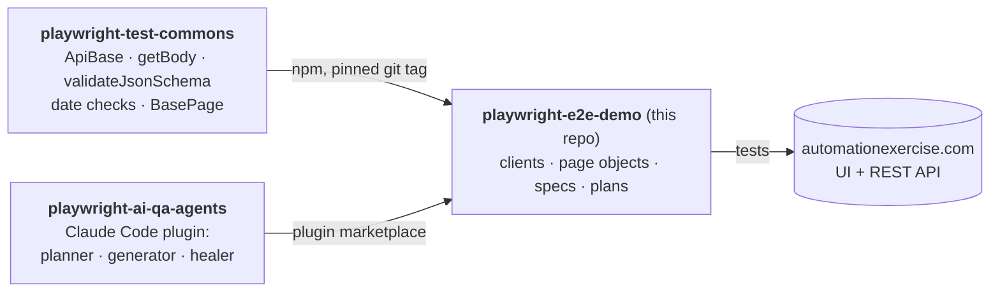

# playwright-e2e-demo

[](https://github.com/benweese/playwright-e2e-demo/actions/workflows/tests.yml)

A TypeScript Playwright API and UI test suite for [automationexercise.com](https://automationexercise.com), a public practice shop. It shows how I structure a test repo: a shared framework installed as a versioned dependency, page objects and API clients, strict schema checks, self-cleaning test data, and AI agents that write tests from a human-reviewed plan.

## How the three repos fit together



| Repo                                                                           | Role                                                            |
| ------------------------------------------------------------------------------ | --------------------------------------------------------------- |
| [playwright-test-commons](https://github.com/benweese/playwright-test-commons) | Site-agnostic framework code, unit tested, released as git tags |
| [playwright-ai-qa-agents](https://github.com/benweese/playwright-ai-qa-agents) | Claude Code agents that plan, generate, run and heal tests      |
| **playwright-e2e-demo**                                                        | This suite: everything specific to automationexercise.com       |

## Status

The framework is in place: smoke tests, the self-cleaning account setup, typed API clients for products and accounts, and the login page object. Feature tests are added with the agents (see [Writing tests with the agents](#writing-tests-with-the-agents)), each starting as a reviewed plan in `plans/`.

## Requirements

- Node 22.22.2+ on 22.x, or 24.15+ (the range the lint tools support; CI uses the version in `.nvmrc`, currently 24)
- No accounts or credentials: the setup project creates a throwaway account through the API and deletes it at the end of the run

## Run it

```bash
git clone https://github.com/benweese/playwright-e2e-demo.git
cd playwright-e2e-demo
npm ci
npx playwright install chromium
npx playwright test                    # every project
```

More ways to run:

```bash
npx playwright test --project=smoke                         # is the site up
npx playwright test --project=api                           # API tests
npx playwright test --project=ui                            # UI tests (runs account setup and teardown around them)
npx playwright test --grep "#0002"                          # one test, by its id
npx playwright test --grep @smoke                           # every test with a tag
npx playwright test tests/smoke/site-up.spec.ts --headed    # one file, in a visible browser
npx playwright show-report                                  # open the last HTML report
```

`npm test`, `npm run test:smoke`, `npm run test:api`, `npm run test:ui` and `npm run report` are shortcuts for the same commands.

For local debugging, copy `.env.example` to `.env` and set:

- `DEBUG_API=true` to log every request and response body
- `UPDATE_SCHEMAS=true` to regenerate JSON schemas from live responses (review the diff, then turn it off)

## What's worth a look

|                                      |                                                                                                                                                                                                                                                                                                                                                                                        |
| ------------------------------------ | -------------------------------------------------------------------------------------------------------------------------------------------------------------------------------------------------------------------------------------------------------------------------------------------------------------------------------------------------------------------------------------- |
| **Self-cleaning auth**               | [`tests/setup/auth.setup.ts`](tests/setup/auth.setup.ts) creates an account via `POST /api/createAccount` with faker data, signs in through the UI and saves the session, so every `@ui` test starts logged in. [`auth.teardown.ts`](tests/setup/auth.teardown.ts) deletes the account and checks it's gone. The shared site is left as it was found.                                  |
| **An API that always says 200**      | The site's API answers HTTP 200 with a `text/html` content type, even for errors, and puts the real status in the body. [`helpers/apiResponse.ts`](helpers/apiResponse.ts) asserts on `responseCode` instead, so error cases are real tests rather than false passes.                                                                                                                  |
| **Ads blocked at the network layer** | Full-page ad vignettes swallow clicks and make UI tests flaky. [`fixtures/test.ts`](fixtures/test.ts) aborts ad and tracking requests in every browser context, and lint makes sure no spec bypasses it.                                                                                                                                                                               |
| **Layered UI tests**                 | Locators → page object → spec ([`tests/ui/`](tests/ui/)). Specs contain no selectors. Locators are `getBy*` only, with no XPath and no `.nth()`, and lint enforces it.                                                                                                                                                                                                                 |
| **Typed end to end**                 | Strict TypeScript throughout. API clients name each response body's type once ([`api/types.ts`](api/types.ts)), and Playwright's typed `APIResponse<T>` carries it into every assertion. Payloads, page objects and imports from commons are typed too. Lint runs `tsc`, so a type error fails CI.                                                                                     |
| **Strict schemas**                   | API specs validate responses against schemas in `schemas/`, generated from real responses, reviewed, and set to `additionalProperties: false`, so an unannounced API change fails a test. Date fields are checked on every validation.                                                                                                                                                 |
| **Plans as test cases**              | Each feature starts as a written plan in `plans/` (a local working file, reviewed before any code is written). Every scenario has an id, a number unique across the repo (`#0012`), that appears in its test title and ties the test to the scenario it implements. Tags (`@smoke`, `@api`, `@ui`), not ids, say what kind of test it is, and lint fails on a missing or duplicate id. |
| **Documented code**                  | Every client method, page object method, locator factory, helper and payload builder has JSDoc, and lint fails on missing or mismatched docs.                                                                                                                                                                                                                                          |

## Layout

```
api/                     API clients (one per area, extending ApiBase) and response types (types.ts)
config/index.ts          site URLs, debug switch and auth file paths
fixtures/test.ts         test/expect with ad and tracking requests blocked
helpers/                 expectResponseCode, readTestUser
payloads/                faker request builders
schemas/                 JSON schemas for API responses
tests/smoke/             @smoke checks
tests/setup/             account create (setup) and delete (teardown)
tests/api/               @api specs
tests/ui/                locators, pages, specs and data for @ui tests
plans/                   test plans (local and git-ignored, except plans/CLAUDE.md)
docs/pages/              page references written by the page-mapper agent
.playwright/             playwright-cli settings, used by the agents
.claude/settings.json    enables the playwright-qa-agents plugin
```

[`CLAUDE.md`](CLAUDE.md) holds the rules that apply everywhere, for people and the AI agents alike. Folders with their own rules have a `CLAUDE.md` of their own ([`api/`](api/CLAUDE.md), [`tests/api/`](tests/api/CLAUDE.md), [`schemas/`](schemas/CLAUDE.md), [`tests/ui/`](tests/ui/CLAUDE.md), [`tests/setup/`](tests/setup/CLAUDE.md), [`plans/`](plans/CLAUDE.md)). Claude Code loads a folder's file only when it works in that folder, so every session starts with half the instructions to read.

## Writing tests with the agents

With [Claude Code](https://claude.com/claude-code) open in this repo, the plugin is enabled automatically through `.claude/settings.json`:

```
/playwright-qa-agents:author-tests the product search page and POST /api/searchProduct
```

The agent maps the page and drafts a plan in `plans/`: acceptance criteria first, then the scenarios that cover them. Then it **stops for review**. Once the plan is approved, it generates the spec, runs it, and repairs UI locators with a three-attempt budget. If the site disagrees with the plan, the test stays failing and the agent offers a bug report. It doesn't rewrite the assertion to match.

## Development

```bash
npm run lint      # ESLint (incl. JSDoc rules) + TypeScript type-check + check-test-ids
npm run lint:fix
npm run format    # Prettier
```

CI (`.github/workflows/tests.yml`) runs lint, the Prettier check and every project on each push and pull request, and daily to catch changes on the live site. The HTML report is uploaded as an artifact.

**Dependencies:** Dependabot opens weekly update pull requests. A few versions are held on purpose, and [`CLAUDE.md`](CLAUDE.md#dependencies) explains each:

- TypeScript is held at 6.x until typescript-eslint supports 7.
- `playwright` is pinned to the same version as `@playwright/test`, because `@playwright/cli` depends on a pre-release `playwright`.
- `minimatch` is overridden to 11.x to fix [GHSA-g3hv-75wg-m249](https://github.com/advisories/GHSA-g3hv-75wg-m249) in ESLint's dependencies.

**Updating commons:** install the new tag, for example `npm install github:benweese/playwright-test-commons#v0.5.1`, then run lint and the tests.

## License

MIT
