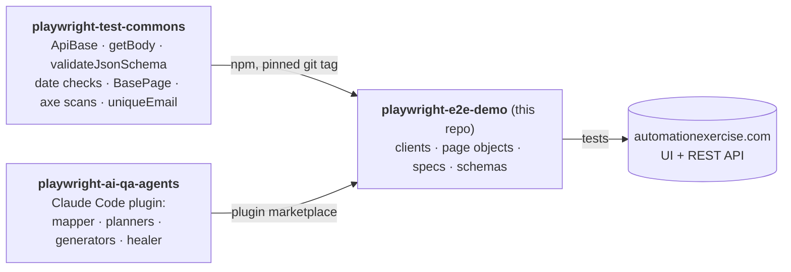

# playwright-e2e-demo

[](https://github.com/benweese/playwright-e2e-demo/actions/workflows/tests.yml)
[](https://code.benweese.com/playwright-e2e-demo/)

A TypeScript Playwright API and UI test suite for [automationexercise.com](https://automationexercise.com), a public practice shop. It shows how I structure a test repo: a shared framework installed as a versioned dependency, page objects and API clients, strict schema checks, self-cleaning test data, accessibility scans, and AI agents that write tests from a plan a human reviews.

The latest HTML report, from `main` and the nightly run, is published to this repo's GitHub Pages site at **[code.benweese.com/playwright-e2e-demo](https://code.benweese.com/playwright-e2e-demo/)**.

By **[Ben Weese](https://benweese.com/)** · more projects at **[code.benweese.com](https://code.benweese.com/)**

## How the three repos fit together



| Repo                                                                           | Role                                                                          |
| ------------------------------------------------------------------------------ | ----------------------------------------------------------------------------- |
| [playwright-test-commons](https://github.com/benweese/playwright-test-commons) | Site-agnostic framework code, unit tested, released as git tags (v0.7.0 here) |
| [playwright-ai-qa-agents](https://github.com/benweese/playwright-ai-qa-agents) | Claude Code agents that map pages, plan, generate, run and heal tests         |
| **playwright-e2e-demo**                                                        | This suite: everything specific to automationexercise.com                     |

## Status

As of November 2026:

| What            | Count                                                                                                                         |
| --------------- | ----------------------------------------------------------------------------------------------------------------------------- |
| Tests           | 54, plus account setup and teardown (56 test ids)                                                                             |
| API tests       | 14, covering all 14 endpoints documented on the [API list](https://automationexercise.com/api_list), 6 of them negative cases |
| UI tests        | 38 in 7 specs: account, products, cart, checkout, contact, subscription, and 6 accessibility scans                            |
| Smoke tests     | 2, also part of the api and ui runs; 11 UI tests carry `@smoke` as well                                                       |
| JSON schemas    | 7, one per response shape                                                                                                     |
| Page references | 9, in [`docs/pages/`](docs/pages/)                                                                                            |
| Runtime         | about 1.5 minutes for the full run, locally, on 2 workers                                                                     |
| Latest full run | 49 of 56 pass. The 7 that fail are the [Findings](#findings): the site doesn't do what its docs say                           |

The suite is red on purpose. A test that finds the site disagreeing with its documentation stays failing; it isn't skipped or marked as expected to fail.

## Findings

Where the site's documented behaviour (its [test cases](https://automationexercise.com/test_cases) and [API list](https://automationexercise.com/api_list)) and its actual behaviour differ. Each has a failing test.

| Test           | Documented / expected                                                             | Actual                                                                                                                                                                   |
| -------------- | --------------------------------------------------------------------------------- | ------------------------------------------------------------------------------------------------------------------------------------------------------------------------ |
| #0042          | Test case 16: after paying, "Your order has been placed successfully!" is visible | The order page shows "Order Placed!" and "Congratulations! Your order has been confirmed!". The documented text is only in a hidden element                              |
| #0051 home     | No WCAG 2 A/AA violations                                                         | Unnamed subscribe button (critical); low contrast on 38 elements, e.g. orange prices at about 2:1 against 4.5:1 (serious); 4 carousel arrows with no link text (serious) |
| #0052 login    | No WCAG 2 A/AA violations                                                         | Unnamed subscribe button; low contrast on the nav link                                                                                                                   |
| #0053 products | No WCAG 2 A/AA violations                                                         | Unnamed search and subscribe buttons; low contrast on 35 elements                                                                                                        |
| #0054 product  | No WCAG 2 A/AA violations                                                         | Unnamed subscribe button; quantity input with no label (critical); low contrast on 4 elements                                                                            |
| #0055 cart     | No WCAG 2 A/AA violations                                                         | Unnamed subscribe button; low contrast on 9 elements                                                                                                                     |
| #0056 contact  | No WCAG 2 A/AA violations                                                         | Unnamed subscribe button; file input with no label (critical); low contrast on the nav link                                                                              |

All 14 API endpoints return the documented `responseCode` and message.

### Observed, not tested

Seen while mapping the pages. The site's docs don't say what should happen in these cases, so there is no test that could assert the right behaviour; they are listed here instead.

- **Fake card details are accepted.** Card number "abcd", CVC "1", month 99 and year 1999 place an order.
- **Quantities of 0 and -1 go into the cart** from the product page; the input's `min=1` isn't enforced.
- **Unknown product ids.** `/product_details/9999` answers 200 with a blank product; `/product_details/abc` shows a Django debug 404 page that lists the site's URL patterns.
- **Checkout isn't guarded.** `/checkout` and `/payment` open when logged out or with an empty cart.
- **The order comment goes nowhere.** It isn't sent with "Place Order" or shown afterwards.
- **Signup form:** the Zipcode label points at the City field, and the date-of-birth selects have no accessible name.
- **The Account Deleted page's title** is still "Automation Exercise - Account Created".
- **The subscription success message** is visible for about one second.

## How these tests were written

Every test here was written by the agents in [playwright-ai-qa-agents](https://github.com/benweese/playwright-ai-qa-agents), with me reviewing at two points:

```
map pages → plan → human review → generate → run → heal → human review
```

1. **Map.** The page-mapper agent surveyed seven areas of the site in a live browser (home, signup/login, products and search, product detail, cart, checkout, contact) and wrote what is actually there, with exact text, to [`docs/pages/`](docs/pages/). Maps describe observed behaviour; they are references for locators, not requirements.
2. **Plan.** The API planner wrote acceptance criteria and scenarios from the API list, and the UI planner from the site's published test cases plus the maps. The plans are committed in [`plans/`](plans/), one per feature: [API products](plans/api-products.md), [API brands](plans/api-brands.md), [API accounts](plans/api-accounts.md), [account](plans/ui-account.md), [products](plans/ui-products.md), [cart](plans/ui-cart.md), [checkout](plans/ui-checkout.md), [contact](plans/ui-contact.md), [subscription](plans/ui-subscription.md) and [accessibility](plans/ui-a11y.md). Each scenario's id (`#0042`) is in its test's title, so a failing test leads straight to its written steps, expected result and the requirement behind it.
3. **Review.** I read every plan before any code was written (changes below).
4. **Generate.** The API and UI generators wrote the clients, page objects, locators, specs and schemas, then linted and ran them.
5. **Heal.** The healer fixed one timing failure (#0037). It was allowed to change locators and waits only, never assertions.
6. **Review.** I read every test and the findings, and changed what is listed below.

### Guardrails the agents worked under

- Assert what the docs and plan say should happen, never what was observed. If the site disagrees, the test fails and goes on the Findings list.
- No defensive guards that let missing data pass, and no conditional `test.skip()`. Findings aren't hidden with `test.fail()` or `test.fixme()` either.
- No fixed waits; web-first assertions or `pollUntil`.
- Soft assertions, so a test reports every problem; no serial mode, so one failure never skips other tests.
- Extend existing specs before creating new ones. Every test creates its own data and deletes it.

### What I changed in review

- **#0042 asserts the documented text.** The planner had written it to expect the text the mapper saw on the page, which would have passed and hidden the mismatch. Now it expects test case 16's wording and fails.
- **Real checks where a test could pass empty.** #0007 must return products for each search term the docs give as an example, and #0017 reads the updated account back instead of trusting "User updated!".
- **"Related" search results** (#0029, #0030) means the term is in the product's name, category or brand, not just its name.
- **Locators.** I allowed stable `data-*` attributes again, and exactly two ids (`#submit_search`, `#subscribe`) for icon-only buttons with no other handle. Locators that still go past those rules, or rely on a weak handle, keep a `// Fixme:` saying what was tried and what the site needs.
- **Findings stay red.** I chose failing tests in the report over `test.fail()`, with soft assertions so every test runs to the end. A generated `test.describe.serial`, which skips the rest of a block after one failure, was taken out.
- **Scope.** I kept the scenarios the planners derived beyond the site's docs (empty forms, cancelled dialogs, case-insensitive search), and kept undocumented API negatives out rather than invent expected codes.
- **Running.** Tests keep both `@smoke` and `@api`/`@ui`, and CI runs the api and ui projects so nothing runs twice. Workers are capped at 2, because more parallel traffic gets "503 heavy load" from the shared site.
- **Test data** uses email addresses on my own domain, from `config.testEmail`, so anything the suite creates is recognisable.
- **Shared code moved to commons.** Helpers the agents wrote here that any site could use (the axe scan, `uniqueEmail`, and page checks for field validation, values, counts, titles, dialogs, uploads and late-bound controls) now live in commons, and this repo keeps only what is specific to automationexercise.com.

## Requirements

- Node 22.22.2+ on 22.x, or 24.15+ (the range the lint tools support; CI uses the version in `.nvmrc`, currently 24)
- No accounts or credentials: the setup project creates a throwaway account through the API and deletes it at the end of the run

## Run it

```bash
git clone https://github.com/benweese/playwright-e2e-demo.git
cd playwright-e2e-demo
npm ci
npx playwright install chromium
npm test                               # api + ui, with account setup and teardown: every test once
```

More ways to run:

```bash
npx playwright test --project=smoke                         # is the site up
npx playwright test --project=api                           # API tests
npx playwright test --project=ui                            # UI tests (runs account setup and teardown around them)
npx playwright test --grep "#0042"                          # one test, by its id
npx playwright test --grep @a11y                            # every test with a tag
npx playwright test tests/smoke/site-up.spec.ts --headed    # one file, in a visible browser
npx playwright show-report                                  # open the last HTML report
```

`npm run test:smoke`, `npm run test:api`, `npm run test:ui` and `npm run report` are shortcuts for the same commands. A bare `npx playwright test` runs every project, so tests tagged both `@smoke` and `@api`/`@ui` run twice; use `npm test`.

For local debugging, copy `.env.example` to `.env` and set:

- `DEBUG_API=true` to log every request and response body
- `UPDATE_SCHEMAS=true` to regenerate JSON schemas from live responses (review the diff, then turn it off)

## What's worth a look

|                                      |                                                                                                                                                                                                                                                                                                                                                                           |
| ------------------------------------ | ------------------------------------------------------------------------------------------------------------------------------------------------------------------------------------------------------------------------------------------------------------------------------------------------------------------------------------------------------------------------- |
| **Self-cleaning test data**          | [`tests/setup/auth.setup.ts`](tests/setup/auth.setup.ts) creates an account via `POST /api/createAccount`, signs in through the UI and saves the session, so `@ui` tests start logged in. [`auth.teardown.ts`](tests/setup/auth.teardown.ts) deletes it. Tests that log in, check out or register create their own accounts through the API and delete them in `finally`. |
| **An API that always says 200**      | The site's API answers HTTP 200 with a `text/html` content type, even for errors, and puts the real status in the body. [`helpers/apiResponse.ts`](helpers/apiResponse.ts) wraps commons' `getBody` and asserts `responseCode`, so error cases are real tests rather than false passes. Every documented negative case has its own named client method.                   |
| **Ads blocked at the network layer** | Full-page ad vignettes swallow clicks and make UI tests flaky. [`fixtures/test.ts`](fixtures/test.ts) aborts ad and tracking requests in every browser context, and lint makes sure no spec bypasses it.                                                                                                                                                                  |
| **Layered UI tests**                 | Locators → page object → spec ([`tests/ui/`](tests/ui/)). Specs contain no selectors. Locators are `getBy*`, or a stable `data-*` attribute where nothing else is unique; no XPath, no `.nth()`, and lint enforces it.                                                                                                                                                    |
| **One cart per test**                | The site keys the cart to the session cookie, so cart and checkout tests each run in a fresh session instead of the shared logged-in one, and never see another test's items.                                                                                                                                                                                             |
| **Accessibility scans**              | [`tests/ui/specs/a11y.spec.ts`](tests/ui/specs/a11y.spec.ts) runs axe-core (commons' `expectNoA11yViolations`) on six key pages against WCAG 2.0, 2.1 and 2.2 A/AA, with no exclusions. Each failure lists the rule, impact and offending elements.                                                                                                                       |
| **Typed end to end**                 | Strict TypeScript throughout. API clients name each response body's type once ([`api/types.ts`](api/types.ts)), and Playwright's typed `APIResponse<T>` carries it into every assertion. Lint runs `tsc`, so a type error fails CI.                                                                                                                                       |
| **Strict schemas**                   | API specs validate every response, errors included, against schemas in [`schemas/`](schemas/): generated from real responses, reviewed, and set to `additionalProperties: false`, so an unannounced API change fails a test. Date fields are checked on every validation.                                                                                                 |
| **Plans as test cases**              | Each feature starts as a written plan with acceptance criteria, reviewed before any code is written. Every scenario has an id, unique across the repo (`#0042`), that appears in its test title. Tags (`@smoke`, `@api`, `@ui`, `@a11y`), not ids, say what kind of test it is, and lint fails on a missing or duplicate id.                                              |
| **Published report**                 | CI deploys the HTML report to GitHub Pages from `main` and the nightly run, failures included, from a job that alone has Pages write access.                                                                                                                                                                                                                              |
| **Documented code**                  | Every client method, page object method, locator factory, helper and payload builder has JSDoc, and lint fails on missing or mismatched docs.                                                                                                                                                                                                                             |

## Layout

```
api/                     API clients (Accounts, Brands, Products, each extending ApiBase) and response types
config/index.ts          site URLs, debug switch, auth file paths, test email domain, slow-step timeouts
fixtures/test.ts         test/expect with ad and tracking requests blocked
helpers/                 expectResponseCode, readTestUser (helpers every repo could use live in commons)
payloads/                faker request builders
schemas/                 JSON schemas for API responses, by area
tests/smoke/             @smoke checks
tests/setup/             account create (setup) and delete (teardown)
tests/api/               @api specs: products, brands, accounts
tests/ui/                locators, pages, specs and data for @ui tests
plans/                   the reviewed test plans: acceptance criteria and scenarios behind every test id
docs/pages/              page references written by the page-mapper agent
.playwright/             playwright-cli settings, used by the agents
.claude/settings.json    names the playwright-qa-agents plugin
```

[`CLAUDE.md`](CLAUDE.md) holds the rules that apply everywhere, for people and the AI agents alike. Folders with their own rules have a `CLAUDE.md` of their own ([`api/`](api/CLAUDE.md), [`tests/api/`](tests/api/CLAUDE.md), [`schemas/`](schemas/CLAUDE.md), [`tests/ui/`](tests/ui/CLAUDE.md), [`tests/setup/`](tests/setup/CLAUDE.md), [`plans/`](plans/CLAUDE.md)). Claude Code loads a folder's file only when it works in that folder, so every session starts with less to read.

## Writing tests with the agents

`.claude/settings.json` names the plugin, but that may not install it: in the VS Code extension it didn't load until it was installed from a terminal, and `/plugin` isn't available there. From a terminal:

```bash
claude plugin marketplace add benweese/playwright-ai-qa-agents
claude plugin install playwright-qa-agents@playwright-ai-qa-agents
```

Plugins load when a session starts, so start a new Claude Code session (or reload the editor) after installing. Then:

```
/playwright-qa-agents:author-tests the product search page and POST /api/searchProduct
```

The agent maps the page and drafts a plan in `plans/`: acceptance criteria first, then the scenarios that cover them. Then it **stops for review**. Once the plan is approved, it generates the spec, runs it, and repairs UI locators with a three-attempt budget. If the site disagrees with the plan, the test stays failing. It doesn't rewrite the assertion to match.

## Development

```bash
npm run lint      # ESLint (incl. JSDoc rules) + TypeScript type-check + check-test-ids
npm run lint:fix
npm run format    # Prettier
```

CI ([`.github/workflows/tests.yml`](.github/workflows/tests.yml)) runs lint, the Prettier check and the api and ui projects on each push and pull request, and daily to catch changes on the live site. The HTML report is uploaded as an artifact on every run, and deployed to GitHub Pages from `main` and the daily run.

**Dependencies:** Dependabot opens weekly update pull requests. A few versions are held on purpose, and [`CLAUDE.md`](CLAUDE.md#dependencies) explains each:

- TypeScript is held at 6.x until typescript-eslint supports 7.
- `playwright` is pinned to the same version as `@playwright/test`, because `@playwright/cli` depends on a pre-release `playwright`.
- `minimatch` is overridden to 11.x to fix [GHSA-g3hv-75wg-m249](https://github.com/advisories/GHSA-g3hv-75wg-m249) in ESLint's dependencies.

**Updating commons:** the suite uses v0.7.0. Install a new tag with `npm install github:benweese/playwright-test-commons#<tag>`, then run lint and the tests.

## Background reading

<!-- TODO: add links to posts on https://benweese.com/blog/ -->

- _Posts about this suite will be listed here, from [benweese.com/blog](https://benweese.com/blog/)._

## License

MIT
