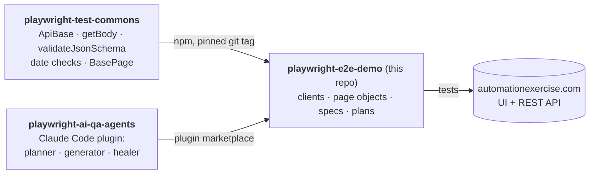

# playwright-e2e-demo

[](https://github.com/benweese/playwright-e2e-demo/actions/workflows/tests.yml)

A TypeScript Playwright API and UI test suite for [automationexercise.com](https://automationexercise.com), a public practice shop. It shows how I structure a test repo: a shared framework installed as a versioned dependency, page objects and API clients, strict schema checks, self-cleaning test data, and AI agents that write tests from a human-reviewed plan.

## How the three repos fit together



| Repo                                                                           | Role                                                            |
| ------------------------------------------------------------------------------ | --------------------------------------------------------------- |
| [playwright-test-commons](https://github.com/benweese/playwright-test-commons) | Site-agnostic framework code, unit tested, released as git tags |
| [playwright-ai-qa-agents](https://github.com/benweese/playwright-ai-qa-agents) | Claude Code agents that plan, generate, run and heal tests      |
| **playwright-e2e-demo**                                                        | This suite: everything specific to automationexercise.com       |

## Run it

```bash
git clone https://github.com/benweese/playwright-e2e-demo.git
cd playwright-e2e-demo
npm ci
npx playwright install chromium
npx playwright test                    # all projects
npx playwright test --project=smoke    # is the site up
npx playwright show-report             # open the HTML report
```

Needs Node 24 (see `.nvmrc`). You don't need accounts or credentials: the setup project creates a throwaway account through the API and deletes it at the end of the run.

```bash
npm run lint    # ESLint (incl. JSDoc rules) + TypeScript type-check + test id check
```

## Status

The framework is in place: the smoke tests, the self-cleaning account setup, the API clients and the login page object. Feature tests are added with the agents (see [Writing tests with the agents](#writing-tests-with-the-agents)), each starting as a reviewed plan in `plans/`.

## What's worth a look

|                                      |                                                                                                                                                                                                                                                                                                                                                       |
| ------------------------------------ | ----------------------------------------------------------------------------------------------------------------------------------------------------------------------------------------------------------------------------------------------------------------------------------------------------------------------------------------------------- |
| **Self-cleaning auth**               | [`tests/setup/auth.setup.ts`](tests/setup/auth.setup.ts) creates an account via `POST /api/createAccount` with faker data, signs in through the UI and saves the session, so every `@ui` test starts logged in. [`auth.teardown.ts`](tests/setup/auth.teardown.ts) deletes the account and checks it's gone. The shared site is left as it was found. |
| **An API that always says 200**      | The site's API answers HTTP 200 with a `text/html` content type, even for errors, and puts the real status in the body. [`helpers/apiResponse.ts`](helpers/apiResponse.ts) asserts on `responseCode` instead, so error cases are real tests rather than false passes.                                                                                 |
| **Ads blocked at the network layer** | Full-page ad vignettes swallow clicks and make UI tests flaky. [`fixtures/test.ts`](fixtures/test.ts) aborts ad and tracking requests in every browser context, and lint makes sure no spec bypasses it.                                                                                                                                              |
| **Layered UI tests**                 | Locators → page object → spec ([`tests/ui/`](tests/ui/)). Specs contain no selectors. Locators are `getBy*` only, with no XPath and no `.nth()`, and lint enforces it.                                                                                                                                                                                |
| **Typed end to end**                 | Strict TypeScript throughout: API clients name each response body's type once ([`api/types.ts`](api/types.ts)) and Playwright's typed `APIResponse<T>` carries it into every assertion, typed request payloads, page objects typed by their locator factories, and typed imports from commons. Lint runs `tsc`, so a type error fails CI.             |
| **Strict schemas**                   | API specs validate responses against schemas in `schemas/`, generated from real responses, reviewed, and set to `additionalProperties: false`, so an unannounced API change fails a test. Date fields are checked on every validation.                                                                                                                |
| **Plans as test cases**              | Each feature gets a written plan in [`plans/`](plans/). Every scenario has an id, a number unique across the repo (`#0012`), that appears in its test title, so a failing test leads straight to its steps and expected result. Tags (`@smoke`, `@api`, `@ui`), not ids, say what kind of test it is, and lint fails on a missing or duplicate id.    |
| **CI**                               | Lint (ESLint, JSDoc rules, type-check, test id check), format check and the full suite on every push, PR and a daily schedule, with the HTML report uploaded as an artifact.                                                                                                                                                                          |

## Layout

```
api/            API clients (one per area, extending ApiBase) and response types
config/         site URLs and settings
fixtures/       test/expect with ad blocking
helpers/        site-specific helpers
payloads/       faker request builders
schemas/        JSON schemas for responses
tests/smoke/    @smoke
tests/setup/    account create / delete
tests/api/      @api specs
tests/ui/       locators, pages, specs, data
plans/          written test plans
docs/pages/     page references used by the agents
scripts/        check-test-ids.ts (part of npm run lint)
.playwright/    playwright-cli settings, used by the agents
```

[`CLAUDE.md`](CLAUDE.md) is the full guide to the repo's rules, which the AI agents also follow.

## Writing tests with the agents

With [Claude Code](https://claude.com/claude-code) open in this repo, the plugin is enabled automatically through `.claude/settings.json`:

```
/playwright-qa-agents:author-tests the product search page and POST /api/searchProduct
```

The agent maps the page and drafts a plan in `plans/`: acceptance criteria first, then the scenarios that cover them. Then it **stops for review**. Once the plan is approved, it generates the spec, runs it, and repairs UI locators with a three-attempt budget. If the site disagrees with the plan, the test stays failing and the agent offers a bug report. It doesn't rewrite the assertion to match.

## License

MIT
